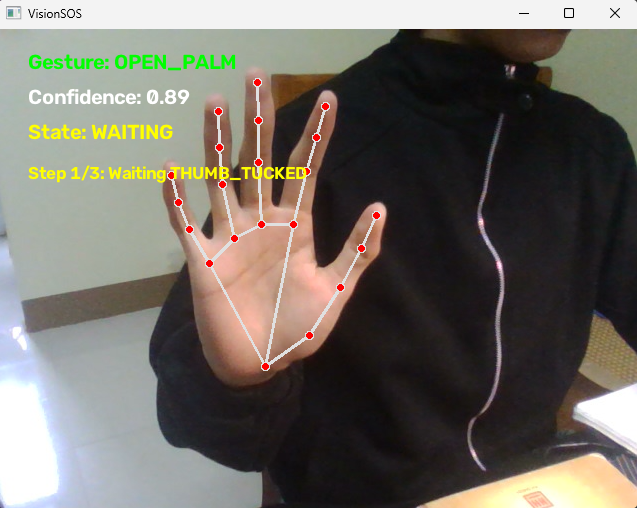
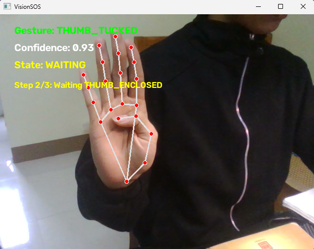
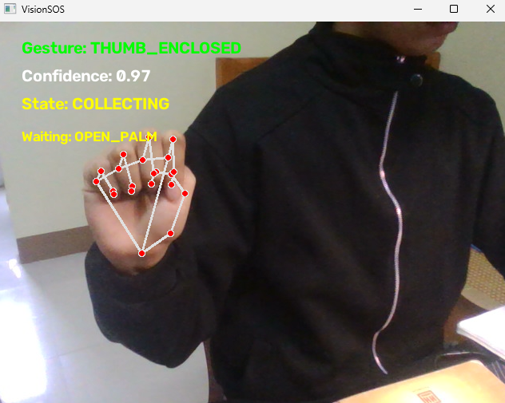
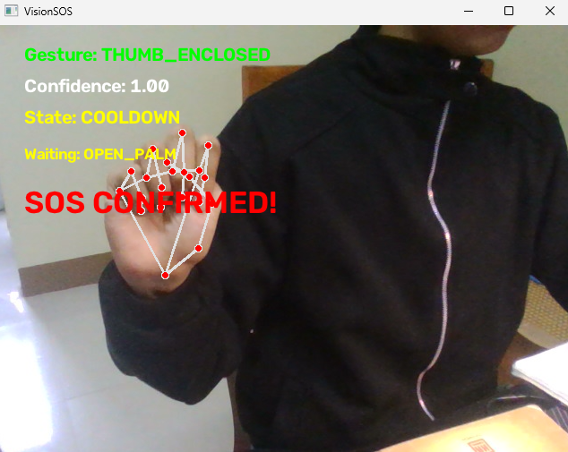

# VisionSOS: Nhận diện cử chỉ cầu cứu theo thời gian thực bằng đặc trưng bàn tay và xác minh chuỗi thời gian.

**VisionSOS** is a computer vision project that detects a predefined sequence of hand gestures to recognize an SOS signal and support people with communication difficulties.

## Features
- Real-time hand detection using MediaPipe.
- Hand landmark extraction and feature processing.
- Hand gesture classification using Random Forest.
- Temporal gesture verification to detect the SOS sequence.
- Webcam-based gesture recognition.

## SOS Gesture Sequence

`OPEN_PALM → THUMB_TUCKED → THUMB_ENCLOSED → SOS_CONFIRMED`

## Demo

The following images illustrate the real-time SOS gesture recognition process:

| Step 1 – OPEN_PALM | Step 2 – THUMB_TUCKED |
|:---:|:---:|
|  |  |

| Step 3 – THUMB_ENCLOSED | Step 4 – SOS_CONFIRMED |
|:---:|:---:|
|  |  |

## Technologies
- Python version 3.11.9
- OpenCV
- MediaPipe
- Scikit-learn
- NumPy

## Installation

Clone the repository:

```bash
git clone <repository-url>
cd VisionSOS
```

Create and activate a virtual environment:

```bash
python -m venv .venv
```

Install dependencies:

```bash
pip install -r requirements.txt
```

## Run the Project

```bash
python -m src.main
```

Make sure your webcam is connected.

## Team Project

VisionSOS is developed as a team project, combining computer vision, machine learning, and real-time gesture recognition.

---

*Built with Python and Computer Vision.*